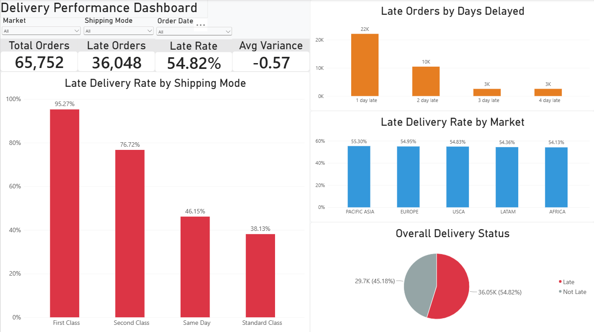

# Supply Chain Delivery Performance Analysis

**Tools:** Microsoft Excel | Power Pivot | Power BI | DAX  
**Focus:** Data Cleaning | Delivery KPIs | Operational Performance | Business Insights

## Project Overview

This project analyses historical supply-chain orders from the **DataCo Smart Supply Chain** dataset to understand delivery performance, identify patterns behind late deliveries, and recommend operational improvements.

The dataset contains approximately **180,519 order-item records**. Because an order can contain multiple items, delivery KPIs use **unique Order IDs** rather than treating every row as a separate delivery.

## Business Questions

1. What percentage of orders are delivered late?
2. Which shipping modes have the highest late-delivery rates?
3. How many days late are delayed orders?
4. Do delivery rates differ significantly across markets?
5. Which improvements should operations teams prioritise?

## Data Preparation and Analysis

I used **Excel** to:

- Check duplicate rows and distinguish valid repeated Order IDs from duplicates.
- Standardise text, numeric and date formats.
- Review missing values and the consistency of delivery-status fields.
- Create **Late / Not Late** and **Days Late** labels.
- Calculate **Schedule Variance = Scheduled Shipping Days - Actual Shipping Days** (negative = late; zero = on schedule; positive = early).
- Explore patterns using PivotTables and Power Pivot.

I then used **Power BI** to calculate and visualise delivery KPIs, compare groups fairly using distinct order counts, and build an interactive dashboard.

### Key Metrics

| Metric | Definition |
| --- | --- |
| Total Orders | Distinct count of Order IDs |
| Late Orders | Distinct count of orders marked as late |
| Late Delivery Rate | Late Orders / Total Orders |
| Average Schedule Variance | Average difference between scheduled and actual shipping days |
| Days Delayed | Number of days an order was late |

## Power BI Dashboard

The dashboard includes KPI cards for total orders, late orders, late-delivery rate and average schedule variance; comparisons by shipping mode and market; days-delayed analysis; overall delivery status; and filters for market, shipping mode and order date.

**[Open the Power BI project file](Dashboard/DataCoSupplyChain_DeliveryKPI_dahsboard.pbix)** (requires Power BI Desktop)

## Key Findings

| Finding | Result | What it means |
| --- | --- | --- |
| Overall delivery performance | **54.82%** of unique orders were late | Delays affect more than half of orders. |
| Shipping mode | **First Class: ~95.27%** late; **Second Class: ~76%** late | These modes should be the first priority for review. |
| Delay duration | Most late orders were **1–2 days** late | Frequent short delays are the main pattern. |
| Market comparison | Late-delivery rates were around **54–55%** across markets | Poor delivery performance is widespread rather than concentrated in one market. |

**Important:** Late-order counts and late-delivery rates should be considered together. High-volume groups may have more late orders even if their rate is comparatively lower.

## Recommendations

1. **Investigate First Class and Second Class shipping:** Review dispatch timing, capacity, bottlenecks and promised lead times.
2. **Reduce recurring 1–2 day delays:** Prioritise repeatable process improvements that address small but frequent overruns.
3. **Review planned shipping durations:** Compare planned times with historical actual performance, then improve processes or adjust unrealistic expectations.
4. **Monitor rates alongside order volumes:** Avoid comparing teams, modes or markets using raw counts alone.

## Repository Files

- [Dashboard screenshot](Dashboard/DataCoSupplyChain_DeliveryKPI_dashboard.png)
- [Power BI dashboard file](Dashboard/DataCoSupplyChain_DeliveryKPI_dahsboard.pbix)
- [Cleaned Excel dataset](Data/Clean_DataCoSupplyChainDataset.xlsx)
- [Dataset field descriptions](Data/DescriptionDataCoSupplyChain.csv)
- [Full portfolio case study (PDF)](Documentation/Supply_Chain_Delivery_Performance_Portfolio_Revised.pdf)

*The original raw dataset is not hosted in this repository.*

## Skills Demonstrated

Data Cleaning · Data Validation · Excel Formulas · PivotTables · Power Pivot · Power BI · DAX · KPI Design · Data Visualisation · Business Analysis · Insight Generation

---

**Author:** Mohamad Fikkri Sarif  
**Project:** Data Analytics Portfolio — Project 1
